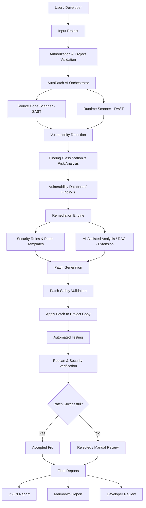

# AutoPatch AI

Automatically detect, classify, repair, and verify security vulnerabilities in Python projects using dual static (SAST) and runtime (DAST) analysis, security rules, AI/RAG remediation, and automated testing verification.

---

## Architecture Flow

The complete automated flow implemented in AutoPatch AI:



---

## Key Stages

1. **User / Developer & Input Project (A → B):** Supply target project path via CLI or Web UI.
2. **Authorization & Project Validation (C):** Checks for `.autopatch.json` with `"authorized": true` and validates repository health, structure, and test commands.
3. **AutoPatch AI Orchestrator (D):** Copies project to an isolated working copy (`work/`), executes baseline tests, and coordinates all stages.
4. **Dual Scanning - SAST & DAST (E & F):**
   - **SAST:** Static AST analysis for code vulnerabilities (SQL injection, unsafe `eval()`, weak hashing, deserialization, broken TLS).
   - **DAST:** Runtime analysis checking active debug modes (`DEBUG = True`), wildcard CORS policies (`*`), and known vulnerable runtime dependencies.
5. **Vulnerability Detection & Normalization (G):** Aggregates findings from both scanners, generates stable fingerprints, and deduplicates records.
6. **Classification & Risk Analysis (H & I):** Computes CVSS-aligned risk scores (0.0 to 10.0), maps CWE and OWASP Top 10 categories, and queries the Vulnerability Database.
7. **Remediation Engine (J):** Routes findings to:
   - **Security Rules & Patch Templates (K):** High-confidence deterministic AST fixers.
   - **AI-Assisted Analysis & RAG Extension (L):** Contextual RAG knowledge retrieval and AI-driven patch synthesis.
8. **Patch Generation & Safety Validation (M & N):** Generates unified diffs and validates Python AST syntax and scope safety before touching the working copy.
9. **Automated Testing & Rescan Verification (O, P, Q):** Applies patch to `work/`, runs the test suite, and rescans with SAST & DAST to verify vulnerability removal and absence of regressions.
10. **Decision Branching (R → S/T):**
    - **Accepted (S):** Tests pass, finding eliminated, no new findings. Saved to `patches/`.
    - **Rejected (T):** Tests fail or finding persists. File reverted to original, failed diff saved to `rejected/`.
11. **Final Reports & Developer Review (U → V, W, X):**
    - Machine-readable JSON report (`report.json`).
    - Human-readable Markdown report (`report.md`).
    - Interactive Developer Review via terminal CLI (`--review`) or Web Dashboard (`--serve`).

---

## Quickstart

### 1. Run Pipeline Scan via CLI

```bash
python -m autopatch examples/vulnerable_app --out autopatch-out
```

### 2. Interactive CLI Developer Review

```bash
python -m autopatch examples/vulnerable_app --out autopatch-out --review
```

### 3. Launch Web Developer Review Dashboard

```bash
python -m autopatch examples/vulnerable_app --serve --port 8765
```
Open [http://localhost:8765](http://localhost:8765) in your browser.

### 4. Apply Accepted Patches Directly to Source

```bash
python -m autopatch examples/vulnerable_app --apply
```

---

## Vulnerability Rule Catalog

| Rule ID | Scanner | Category | CWE | Severity | Remediation Strategy |
|---------|---------|----------|-----|----------|----------------------|
| **AP001** | SAST | SQL Injection | CWE-89 | High | Parameterized queries with placeholder binding |
| **AP002** | SAST | Code Injection (`eval`) | CWE-95 | Critical | `ast.literal_eval()` or safe parser |
| **AP003** | SAST | Cryptography (MD5/SHA1) | CWE-327 | Medium | `hashlib.sha256()` |
| **AP004** | SAST | Deserialization (`yaml.load`) | CWE-502 | High | `yaml.safe_load()` |
| **AP005** | SAST | Transport Security (`verify=False`)| CWE-295 | High | `verify=True` |
| **AP006** | SAST | Hardcoded Credentials | CWE-798 | High | AI/RAG `os.environ.get()` or manual review |
| **AP007** | SAST | OS Command Injection | CWE-78 | Critical | `subprocess.run(shell=False)` |
| **DAST001** | DAST | Active Debug Mode | CWE-489 | High | Inactive runtime debug mode |
| **DAST002** | DAST | Permissive Wildcard CORS | CWE-942 | Medium | Restricted explicit origin configuration |
| **DAST003** | DAST | Vulnerable Dependencies | CWE-1395 | High | Version advisory upgrade |
| **DAST004** | DAST | Runtime SQL Probe Anomaly | CWE-89 | High | Parameterized query enforcement |

---

## Configuration (`.autopatch.json`)

Place `.autopatch.json` in your repository root:

```json
{
  "authorized": true,
  "disabled_rules": [],
  "exclude_dirs": ["migrations", "legacy"],
  "placeholder": "?",
  "test_command": "python -m unittest discover -s tests -t . -q"
}
```

---

## Running AutoPatch Tests

```bash
python -m unittest discover -s tests -q
```
