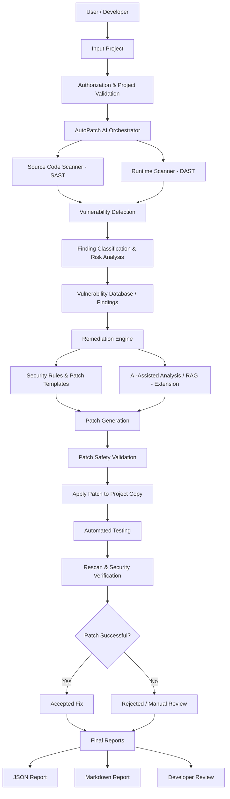

# AutoPatch AI Security Report: vulnerable_app

> **Generated at:** 2026-11-07T13:26:37+00:00 | **Python:** 3.13.5 | **Authorization:** Verified

## Pipeline Architecture Execution



## Executive Summary

- **Total Findings Detected:** `8`
- **Accepted & Verified Patches:** `6`
- **Rejected Patches:** `1`
- **Manual Review Required:** `1`
- **SAST Findings:** `7` | **DAST Findings:** `1`

## Vulnerability Findings & Risk Summary

| # | Scanner | Rule & CWE | Severity | Risk Score | Location | Outcome | Strategy |
|---|---------|------------|----------|------------|----------|---------|----------|
| 1 | SAST | AP002 (CWE-95) | CRITICAL | 9.8/10 | `app/utils.py:5` | Accepted | rule_template |
| 2 | SAST | AP006 (CWE-798) | HIGH | 7.4/10 | `app/config.py:2` | Accepted | ai_assisted_rag |
| 3 | DAST | DAST001 (CWE-489) | HIGH | 7.4/10 | `app/config.py:4` | Accepted | rule_template |
| 4 | SAST | AP001 (CWE-89) | HIGH | 8.8/10 | `app/db.py:3` | Accepted | rule_template |
| 5 | SAST | AP001 (CWE-89) | HIGH | 8.8/10 | `app/db.py:9` | Accepted | rule_template |
| 6 | SAST | AP001 (CWE-89) | HIGH | 8.8/10 | `app/db.py:15` | Manual review | manual_review |
| 7 | SAST | AP003 (CWE-327) | MEDIUM | 5.3/10 | `app/utils.py:10` | Accepted | rule_template |
| 8 | SAST | AP003 (CWE-327) | MEDIUM | 5.3/10 | `app/utils.py:14` | Rejected (original preserved) | rule_template |

## Detailed Remediation & Developer Review

### 1. [CRITICAL] eval() on dynamic input (`app/utils.py:5`)
- **Rule ID:** `AP002` | **CWE:** CWE-95 | **OWASP:** A03:2021-Injection
- **Scanner:** SAST | **Confidence:** 99%
- **Status:** **Accepted** (0.198s)
- **Outcome Reason:** Patch passed safety checks, project tests passed, and rescan verified fix.

> **AI Analysis & RAG Context:**
> ### AI-Assisted Security Analysis: eval() on dynamic input
> 
> **Classification:** CWE-95 (A03:2021-Injection) | **Severity:** CRITICAL
> 
> **Root Cause:** In `app/utils.py` at line 5, the application performs: `return eval(expr)`. The built-in `eval()` function is invoked with dynamic or untrusted input. In Python, `eval()` executes arbitrary Python code in the current runtime context, enabling remote code execution (RCE) and full host compromise.
> 
> **Attack Vector & Impact:** Remote code execution (RCE), complete system takeover, arbitrary file access.
> 
> **Recommended Remediation:** Replace `eval()` with `ast.literal_eval()` when parsing Python literal expressions (strings, numbers, tuples, lists, dicts, booleans, and None), or use `json.loads()` for structured data.

#### Proposed & Verified Diff
```diff
--- a/app/utils.py
+++ b/app/utils.py
@@ -1,8 +1,9 @@
 import hashlib
+import ast
 
 
 def parse_discount(expr):
-    return eval(expr)
+    return ast.literal_eval(expr)
 
 
 def cache_key(text):
```

### 2. [HIGH] Hardcoded credential (`app/config.py:2`)
- **Rule ID:** `AP006` | **CWE:** CWE-798 | **OWASP:** A07:2021-Identification and Authentication Failures
- **Scanner:** SAST | **Confidence:** 90%
- **Status:** **Accepted** (0.188s)
- **Outcome Reason:** Patch passed safety checks, project tests passed, and rescan verified fix.

> **AI Analysis & RAG Context:**
> ### AI-Assisted Security Analysis: Hardcoded credential
> 
> **Classification:** CWE-798 (A07:2021-Identification and Authentication Failures) | **Severity:** HIGH
> 
> **Root Cause:** In `app/config.py` at line 2, the application performs: `API_PASSWORD = "****"`. Sensitive credentials such as passwords, API keys, or tokens are hardcoded into source files. Hardcoded secrets are easily extracted via source repositories, build artifacts, or application logs.
> 
> **Attack Vector & Impact:** Unauthorized system access, compromised third-party accounts, privilege escalation.
> 
> **Recommended Remediation:** Rotate the exposed secret immediately. Extract credentials into environment variables (e.g., using `os.environ.get(...)`) or a dedicated secret management vault.

#### Proposed & Verified Diff
```diff
--- a/app/config.py
+++ b/app/config.py
@@ -1,3 +1,4 @@
+import os
 DB_PATH = "app.db"
-API_PASSWORD = "hunter2-prod-key"
-DEBUG = True
+API_PASSWORD = os.environ.get("API_PASSWORD", "")
+DEBUG = True
```

### 3. [HIGH] Insecure runtime debug mode active (`app/config.py:4`)
- **Rule ID:** `DAST001` | **CWE:** CWE-489 | **OWASP:** A05:2021-Security Misconfiguration
- **Scanner:** DAST | **Confidence:** 95%
- **Status:** **Accepted** (0.193s)
- **Outcome Reason:** Patch passed safety checks, project tests passed, and rescan verified fix.

> **AI Analysis & RAG Context:**
> ### AI-Assisted Security Analysis: Insecure runtime debug mode active
> 
> **Classification:** CWE-489 (A05:2021-Security Misconfiguration) | **Severity:** HIGH
> 
> **Root Cause:** In `app/config.py` at line 3, the application performs: `DEBUG = True`. Application runtime configuration has `DEBUG = True` enabled. Active debug modes in runtime often expose interactive tracebacks, internal configuration, secret keys, and interactive debug consoles.
> 
> **Attack Vector & Impact:** Information disclosure, credential leakage, possible remote code execution via debug consoles.
> 
> **Recommended Remediation:** Set `DEBUG = False` in runtime configuration or load debug setting dynamically from an environment variable with a safe default.

#### Proposed & Verified Diff
```diff
--- a/app/config.py
+++ b/app/config.py
@@ -1,4 +1,4 @@
 import os
 DB_PATH = "app.db"
 API_PASSWORD = os.environ.get("API_PASSWORD", "")
-DEBUG = True+DEBUG = False
```

### 4. [HIGH] SQL injection via dynamically built query (`app/db.py:3`)
- **Rule ID:** `AP001` | **CWE:** CWE-89 | **OWASP:** A03:2021-Injection
- **Scanner:** SAST | **Confidence:** 98%
- **Status:** **Accepted** (0.187s)
- **Outcome Reason:** Patch passed safety checks, project tests passed, and rescan verified fix.

> **AI Analysis & RAG Context:**
> ### AI-Assisted Security Analysis: SQL injection via dynamically built query
> 
> **Classification:** CWE-89 (A03:2021-Injection) | **Severity:** HIGH
> 
> **Root Cause:** In `app/db.py` at line 3, the application performs: `cur.execute(f"SELECT id, username FROM users WHERE username = '{username}'")`. Untrusted input is concatenated, formatted, or interpolated directly into an SQL statement executed by a database cursor. An attacker can manipulate the query structure to bypass authentication, view unauthorized data, or modify database records.
> 
> **Attack Vector & Impact:** Data breach, data loss, unauthorized administrative access, privilege escalation.
> 
> **Recommended Remediation:** Use parameterized queries with placeholder binding (e.g., '?' for SQLite or '%s' for PostgreSQL/MySQL) and pass variables as a separate parameter sequence. Never construct SQL commands by joining or formatting strings with user input.

#### Proposed & Verified Diff
```diff
--- a/app/db.py
+++ b/app/db.py
@@ -1,6 +1,6 @@
 def get_user(conn, username):
     cur = conn.cursor()
-    cur.execute(f"SELECT id, username FROM users WHERE username = '{username}'")
+    cur.execute("SELECT id, username FROM users WHERE username = ?", (username,))
     return cur.fetchone()
```

### 5. [HIGH] SQL injection via dynamically built query (`app/db.py:9`)
- **Rule ID:** `AP001` | **CWE:** CWE-89 | **OWASP:** A03:2021-Injection
- **Scanner:** SAST | **Confidence:** 98%
- **Status:** **Accepted** (0.183s)
- **Outcome Reason:** Patch passed safety checks, project tests passed, and rescan verified fix.

> **AI Analysis & RAG Context:**
> ### AI-Assisted Security Analysis: SQL injection via dynamically built query
> 
> **Classification:** CWE-89 (A03:2021-Injection) | **Severity:** HIGH
> 
> **Root Cause:** In `app/db.py` at line 9, the application performs: `cur.execute("SELECT id, total FROM orders WHERE status = '" + status + "'")`. Untrusted input is concatenated, formatted, or interpolated directly into an SQL statement executed by a database cursor. An attacker can manipulate the query structure to bypass authentication, view unauthorized data, or modify database records.
> 
> **Attack Vector & Impact:** Data breach, data loss, unauthorized administrative access, privilege escalation.
> 
> **Recommended Remediation:** Use parameterized queries with placeholder binding (e.g., '?' for SQLite or '%s' for PostgreSQL/MySQL) and pass variables as a separate parameter sequence. Never construct SQL commands by joining or formatting strings with user input.

#### Proposed & Verified Diff
```diff
--- a/app/db.py
+++ b/app/db.py
@@ -6,7 +6,7 @@
 
 def search_orders(conn, status):
     cur = conn.cursor()
-    cur.execute("SELECT id, total FROM orders WHERE status = '" + status + "'")
+    cur.execute("SELECT id, total FROM orders WHERE status = ?", (status,))
     return cur.fetchall()
```

### 6. [HIGH] SQL injection via dynamically built query (`app/db.py:15`)
- **Rule ID:** `AP001` | **CWE:** CWE-89 | **OWASP:** A03:2021-Injection
- **Scanner:** SAST | **Confidence:** 98%
- **Status:** **Manual review** (0.001s)
- **Outcome Reason:** No automatic rule template or AI patch available for this code pattern.

> **AI Analysis & RAG Context:**
> ### AI-Assisted Security Analysis: SQL injection via dynamically built query
> 
> **Classification:** CWE-89 (A03:2021-Injection) | **Severity:** HIGH
> 
> **Root Cause:** In `app/db.py` at line 15, the application performs: `cur.execute(f"SELECT id, name FROM products WHERE name LIKE '%{term}%'")`. Untrusted input is concatenated, formatted, or interpolated directly into an SQL statement executed by a database cursor. An attacker can manipulate the query structure to bypass authentication, view unauthorized data, or modify database records.
> 
> **Attack Vector & Impact:** Data breach, data loss, unauthorized administrative access, privilege escalation.
> 
> **Recommended Remediation:** Use parameterized queries with placeholder binding (e.g., '?' for SQLite or '%s' for PostgreSQL/MySQL) and pass variables as a separate parameter sequence. Never construct SQL commands by joining or formatting strings with user input.

### 7. [MEDIUM] Weak cryptographic hash algorithm (MD5 / SHA-1) (`app/utils.py:10`)
- **Rule ID:** `AP003` | **CWE:** CWE-327 | **OWASP:** A02:2021-Cryptographic Failures
- **Scanner:** SAST | **Confidence:** 97%
- **Status:** **Accepted** (0.173s)
- **Outcome Reason:** Patch passed safety checks, project tests passed, and rescan verified fix.

> **AI Analysis & RAG Context:**
> ### AI-Assisted Security Analysis: Weak cryptographic hash algorithm (MD5 / SHA-1)
> 
> **Classification:** CWE-327 (A02:2021-Cryptographic Failures) | **Severity:** MEDIUM
> 
> **Root Cause:** In `app/utils.py` at line 9, the application performs: `return hashlib.sha1(text.encode()).hexdigest()`. The code uses MD5 or SHA-1 for hashing. Both algorithms have known collision attacks and are cryptographically broken for digital signatures, integrity verification, and credential storage.
> 
> **Attack Vector & Impact:** Hash collision attacks, credential cracking, signature forgery.
> 
> **Recommended Remediation:** Use secure collision-resistant hash algorithms such as SHA-256 or SHA-512 from `hashlib`. For password hashing, use dedicated slow algorithms such as Argon2, bcrypt, or scrypt.

#### Proposed & Verified Diff
```diff
--- a/app/utils.py
+++ b/app/utils.py
@@ -7,7 +7,7 @@
 
 
 def cache_key(text):
-    return hashlib.sha1(text.encode()).hexdigest()
+    return hashlib.sha256(text.encode()).hexdigest()
 
 
 def legacy_signature(payload):
```

### 8. [MEDIUM] Weak cryptographic hash algorithm (MD5 / SHA-1) (`app/utils.py:14`)
- **Rule ID:** `AP003` | **CWE:** CWE-327 | **OWASP:** A02:2021-Cryptographic Failures
- **Scanner:** SAST | **Confidence:** 97%
- **Status:** **Rejected (original preserved)** (0.174s)
- **Outcome Reason:** Automated tests failed after applying the patch.

> **AI Analysis & RAG Context:**
> ### AI-Assisted Security Analysis: Weak cryptographic hash algorithm (MD5 / SHA-1)
> 
> **Classification:** CWE-327 (A02:2021-Cryptographic Failures) | **Severity:** MEDIUM
> 
> **Root Cause:** In `app/utils.py` at line 13, the application performs: `return hashlib.md5(payload.encode()).hexdigest()`. The code uses MD5 or SHA-1 for hashing. Both algorithms have known collision attacks and are cryptographically broken for digital signatures, integrity verification, and credential storage.
> 
> **Attack Vector & Impact:** Hash collision attacks, credential cracking, signature forgery.
> 
> **Recommended Remediation:** Use secure collision-resistant hash algorithms such as SHA-256 or SHA-512 from `hashlib`. For password hashing, use dedicated slow algorithms such as Argon2, bcrypt, or scrypt.

#### Proposed & Verified Diff
```diff
--- a/app/utils.py
+++ b/app/utils.py
@@ -11,4 +11,4 @@
 
 
 def legacy_signature(payload):
-    return hashlib.md5(payload.encode()).hexdigest()
+    return hashlib.sha256(payload.encode()).hexdigest()
```

## Performance Metrics

| Pipeline Stage | Wall-Clock Seconds |
|----------------|--------------------|
| `copy_project` | 0.023s |
| `baseline_tests` | 0.191s |
| `sast_scan` | 0.004s |
| `dast_scan` | 0.006s |
| `risk_analysis` | 0.000s |
| `total` | 1.561s |

**Mean Time Per Accepted Fix:** `0.187s`
**Total Pipeline Execution Time:** `1.561s`

